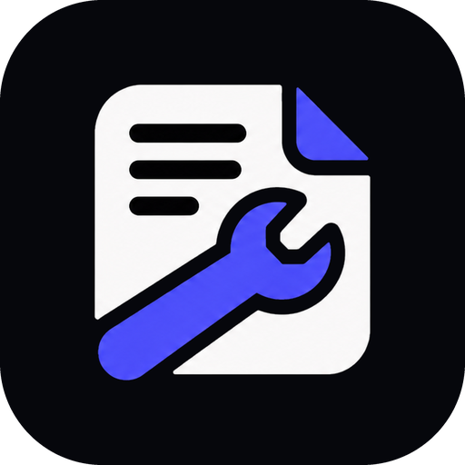

<div align="center">



# FixREADME

**Turn any public GitHub repository, or a few rough notes, into a clear, complete and professional README.**


[Introduction](#introduction) • [Features](#features) • [Quick Start](#quick-start) • [Generated README](#what-a-generated-readme-looks-like) • [AI Settings](#ai-settings) • [GitHub Token](#github-token) • [Project Structure](#project-structure) • [Limits](#limits)

</div>

## Introduction

**FixREADME** is a small web application that writes the README your project deserves. Paste the link to a public GitHub repository, or drop in a few lines of notes, and it reads the project the way a new contributor would: the metadata, the languages, the file tree, the dependency manifests and the key source files. From that evidence it composes a README with a centered header, an introduction, a feature list, installation steps with copy-ready commands, a project structure, and contributing and license sections.

Most READMEs are weak for the same reasons. They were written in a hurry, they leave out the install commands, and they go stale as the code changes. FixREADME removes the blank page. Every statement it makes about your project is tied to something it actually found, so the result is accurate rather than generic, and nothing is invented to fill space.

It is built with Flask and runs entirely on your computer. By default the prose is written by a small free local model (Ollama), so no account or API key is needed. If you want richer writing you can plug in OpenAI, any OpenAI-compatible service, or Anthropic Claude from the Settings dialog. The structure of the output follows what the most popular repositories on GitHub do: a clear title and tagline, a few meaningful badges, one-line navigation, an introduction that explains the project, and a quick start that gets a reader running in minutes.

## Features

- **Reads real evidence.** Metadata, languages, the file tree, manifests such as `package.json` and `requirements.txt`, and key source files are all inspected, so features, frameworks, install commands and run commands come from the project itself.
- **Introduction first.** Every README opens with a descriptive introduction covering what the project is, what it offers and where to start, followed by sections that are written in full sentences rather than fragments.
- **Compact navigation.** Instead of a long table of contents that pushes the content down the page, a single line of links such as `Introduction • Features • Quick Start` sits under the title. A long table of contents already in a README is folded into the same line.
- **Centered header like the top repositories.** Title, tagline, badges and links are centered. If the repository already ships a `logo` or `banner` image it is shown above the title automatically.
- **Badges in the markdown-badges style.** Up to eight `for-the-badge` badges show live project stats and the technologies really in use. Any existing "verified" or "fixreadme" badge is removed.
- **Copy buttons everywhere.** Every command in the preview has a Copy button, and the header Copy button copies the whole file.
- **Focused output.** API endpoint tables and testing sections are left out, and test files are hidden from the project tree, so the README stays about what a new reader needs.
- **Your choice of AI.** Use the free local model, an OpenAI-compatible API or Anthropic Claude. Evidence-based sections are always kept, whichever model writes the prose.
- **Light and dark themes.** Switch from the header. The choice is remembered, and the first visit follows your system setting.

## Quick Start

You need Python 3.9 or newer and an internet connection for GitHub analysis and badge images. [Ollama](https://ollama.com) is optional and provides the free local model.

**Step 1: Install the dependencies**

```bash
pip install -r requirements.txt
```

**Step 2: Start the app**

```bash
python app.py
```

**Step 3: Open it in your browser**

Go to http://127.0.0.1:5000, paste a repository URL or some notes, and select **Generate README**. Use **Preview** to read the result and **Source** to see the raw Markdown.

When the app starts, it prints its progress in the terminal:

```text
[FixREADME] Checking for Ollama...
[FixREADME] Found Ollama: /usr/local/bin/ollama
[FixREADME] Starting 'ollama serve' ...
[FixREADME] Model 'qwen2.5:0.5b' is ready.
```

If Ollama is not installed the app still runs. READMEs are then built from the repository evidence alone, and you can add an API key in Settings at any time.

## What a Generated README Looks Like

Generated READMEs follow the same shape as the best-loved projects on GitHub:

1. **Header block.** Optional logo, title, a one-line tagline, up to eight badges, and a single line of navigation links.
2. **Introduction.** Two to four paragraphs describing what the project is, what it offers, how large it is, and where to start.
3. **Features.** One descriptive bullet per capability that was actually detected.
4. **Prerequisites and Quick Start.** The tools to install, then numbered steps with copy-ready `git clone`, install and run commands, and the address to open.
5. **Technologies, How It Works and Project Structure.** What each language and framework does, what each module is for, and an annotated file tree.
6. **Contributing, Support and License.** Friendly guidance for people who want to help, and the license that was found.

## Local Model

By default the app uses `qwen2.5:0.5b`, a small model (about 400 MB) so the first download is quick. Choose a different model with an environment variable:

```bash
FIXREADME_OLLAMA_MODEL=llama3.2:1b python app.py
```

The Ollama server's own log is written to `ollama-serve.log` in the project folder, so the terminal stays readable.

## AI Settings

Click the gear icon to choose a provider:

- **Local Ollama (default)**: no key needed. Leave the base URL empty to use the local server.
- **OpenAI or compatible API**: any OpenAI-style endpoint, such as OpenAI, OpenRouter, Groq, or LM Studio. Set the base URL for non-OpenAI services.
- **Anthropic Claude**: requires an API key.

Keys are kept in your browser's local storage and sent only with your own requests. The server does not store them, and they are never written to the terminal or the log. Use **Test connection** to check a setting before you save it.

If the AI call fails, the app shows the reason and still produces a README from the repository evidence.

## GitHub Token

Without a token, GitHub allows only 60 repository reads per hour, and FixREADME stops with a rate-limit message. A free token raises the limit to 5,000 per hour. For public repositories the token needs **no permissions**.

1. Create a token at https://github.com/settings/tokens.
2. Give it to FixREADME in one of two ways:

| Way | How | Where the token lives |
| --- | --- | --- |
| Server (safest) | Copy `.env.example` to `.env` and set `GITHUB_TOKEN=your_token` | Only on your computer. Never sent to the browser. `.env` is in `.gitignore`. |
| Browser | Open Settings (gear icon) and paste it in **GitHub token** | This tab only, or this device if you tick **Remember on this device** |

How the token is protected:

- The field is hidden by default. **Show** and **Hide** toggle it, and it hides again every time Settings closes.
- **Test token** shows how many reads you have left. **Remove token** deletes it from the browser.
- The token is checked for a valid shape, sent only to `api.github.com`, and never written to the terminal, logs, or JSON files. Error messages never repeat it.
- A token pasted in the browser is used first; otherwise the server's `GITHUB_TOKEN` is used.

## Badges

Generated READMEs use the static `for-the-badge` style from [markdown-badges](https://github.com/Ileriayo/markdown-badges), for example:

```markdown

```

For a GitHub repository the first three badges show live project stats (stars, forks, license, latest release, or last commit). The rest show the languages, frameworks, and tools the project really uses, such as Python, Flask, Docker, or GitHub Actions. The catalog lives in `badges.py`; add a line there to support another technology.

## Learn From the Best Repositories

`trending_repos.py` finds popular GitHub repositories, studies their READMEs, scores them, and saves the results as JSON. With a token it collects **1,000 repositories** by default.

```bash
cp .env.example .env        # then put your token after GITHUB_TOKEN=
python trending_repos.py
```

It needs a few GitHub requests per repository, so a token is required for 1,000 (without one it stops at 40). If GitHub's rate limit is reached, the program **waits for it to reset** instead of stopping. Progress is saved after every repository, so if you stop it with Ctrl+C you can run it again and it continues where it left off. A full run can take an hour or more.

Useful options:

```bash
python trending_repos.py --limit 500 --min-score 65
python trending_repos.py --orgs google microsoft vercel
python trending_repos.py --language python typescript
python trending_repos.py --fresh        # ignore saved progress and start over
python trending_repos.py --no-wait      # stop at the rate limit instead of waiting
```

**Where repositories come from**

| Category | How it is found |
| --- | --- |
| `top` | Most-starred repositories on GitHub |
| `famous` | Well-known repositories (10,000+ stars) that are still being updated |
| `trending` | New repositories (last 30 days) that are gaining stars quickly |
| `viral` | Repositories created in the last 90 days that already have thousands of stars |
| `big_company` | Top repositories from organisations such as Google, Microsoft, Meta, Netflix, Vercel, and Hugging Face |

Forks and archived repositories are skipped.

**How the score works (0 to 100)**

| Part | Points | What it measures |
| --- | --- | --- |
| Popularity | 25 | Star count on a log scale |
| Momentum | 15 | Stars gained per day of the repository's life |
| Community | 10 | Forks, watchers, and fork-to-star ratio |
| Maintenance | 15 | How recently the project was updated |
| README quality | 25 | Install and usage sections, features, table of contents, badges, images, code samples, and length |
| Project health | 10 | License, CI, docs, examples, changelog, contributing guide, and security policy |

Repositories from big companies get a small bonus of 2 points. Every record in `repos_data.json` includes its `score_breakdown`, so each score can be checked.

**Files it writes** (in `data/`)

| File | Contents |
| --- | --- |
| `repos_data.json` | Every repository inspected, with categories, README features, project signals, and score |
| `best_repos.json` | Only repositories at or above `--min-score` (default 60), best first |
| `feature_profile.json` | What the best repositories have in common: how often each README section appears, common headings, average badges and code blocks, and common feature words |
| `progress.jsonl` | Saved progress that lets an interrupted run continue (not needed afterwards) |

**How FixREADME uses it.** When `data/feature_profile.json` exists, FixREADME adds the sections that at least half of the best repositories include (for example table of contents, contributing, and support). Before the first run it uses a built-in list of the same common sections. Sections are only added when they are supported by the repository, and nothing is copied from the scored repositories.

## Project Structure

The layout below shows where everything lives. Each folder holds one kind of file.

```text
fix_readme_project/
├── app.py               # Flask web application
├── analyzer.py          # evidence gathering and README composition
├── badges.py            # badge catalog (markdown-badges style)
├── best_practices.py    # reads data/feature_profile.json
├── trending_repos.py    # finds, scores, and saves top repositories
├── repo_fetch.py        # reads public GitHub repositories
├── llm.py               # AI providers and the writing prompt
├── local_ai.py          # starts and checks the local Ollama model
├── config.py            # central settings
├── requirements.txt     # Python dependencies
├── .env.example         # copy to .env and add GITHUB_TOKEN
├── data/                # JSON written by trending_repos.py
├── static/              # CSS, JavaScript, loader animation and images
│   └── img/             # logo, favicon and app icons
├── templates/           # HTML page
└── tests/               # automated tests
```

## Limits

Private repositories are not fetched. Without a GitHub token the limit is 60 reads per hour; see [GitHub Token](#github-token). Analysis is heuristic: it reports only patterns it can find in the project, and it does not claim that a feature is production-ready.
